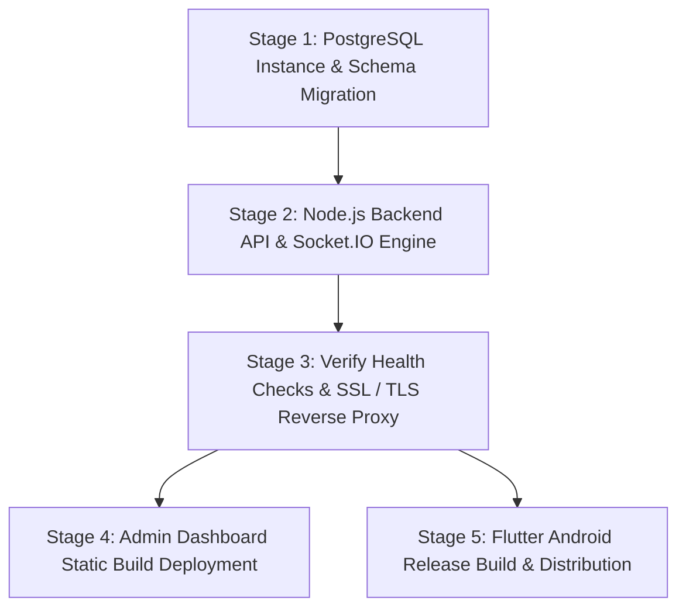

# Scan. Pay. Go. — Production Deployment Guide

This document defines the authoritative, step-by-step production deployment strategy for the **Scan. Pay. Go.** self-checkout retail platform across all system tiers:
1. **Database Layer**: PostgreSQL 14+ with TLS/SSL & Connection Pooling
2. **Backend API Layer**: Node.js + Express + TypeScript + Socket.IO with PM2 & Nginx Reverse Proxy
3. **Admin Dashboard**: React + TypeScript + Vite + Tailwind CSS deployed to a secure static CDN/Nginx
4. **Customer Mobile Application**: Flutter Android Release APK / Google Play App Bundle (AAB)

---

## 1. Architecture & Deployment Order

To guarantee zero runtime connection errors and complete data consistency, services must be deployed in the following strict sequential order:



---

## 2. Stage 1: PostgreSQL Database Setup

### 2.1 Database Provisioning
- **Recommended Providers**: AWS RDS PostgreSQL, DigitalOcean Managed Database, Supabase, Neon, or Docker PostgreSQL on dedicated VPS.
- **Minimum Requirements**: PostgreSQL 14+, 2 vCPUs, 4GB RAM, SSD storage.
- **Connection Security**: Enforce TLS/SSL (`sslmode=require`) and restrict inbound access to the Backend server IP or private VPC subnet.

### 2.2 Schema & Initial Data Migration
Run the DDL schema and initial dataset scripts against the production database:

```bash
# 1. Connect to production PostgreSQL
psql -h <PROD_DB_HOST> -p <PROD_DB_PORT> -U <PROD_DB_USER> -d <PROD_DB_NAME>

# 2. Execute schema migration
\i database/schema.sql

# 3. (Optional) Execute initial catalog seed data
\i database/seed.sql
```

### 2.3 Database Backup & Maintenance Strategy
- **Automated Daily Backups**: Configure cloud provider daily automated snapshots with 30-day retention.
- **Manual Dump Command**:
  ```bash
  pg_dump -h <PROD_DB_HOST> -U <PROD_DB_USER> -d <PROD_DB_NAME> -F c -b -v -f "scan_pay_go_backup_$(date +%Y%m%d_%H%M%S).dump"
  ```
- **Connection Pooling**: Backend is configured with `pg.Pool` (`max: 20` connections per worker instance, `idleTimeoutMillis: 30000`).

---

## 3. Stage 2: Node.js / Express Backend Deployment

### 3.1 Production Environment Variables (`backend/.env`)

Create `/var/www/scan-pay-go/backend/.env` with strict production secrets (never commit this file):

```env
# Server
PORT=5000
NODE_ENV=production

# PostgreSQL Database (Internal VPC / SSL)
PGHOST=db.internal.yourdomain.com
PGPORT=5432
PGUSER=scanpaygo_admin
PGPASSWORD=STRONG_PRODUCTION_DB_PASSWORD_HERE
PGDATABASE=scan_pay_go_prod
PGSSL=true

# Security & Cryptographic Secrets
JWT_SECRET=SECURE_64_CHAR_RANDOM_HEX_JWT_SECRET_STRING_HERE
JWT_EXPIRES_IN=1d
JWT_REFRESH_SECRET=SECURE_64_CHAR_RANDOM_HEX_REFRESH_SECRET_STRING_HERE
EXIT_QR_SECRET=SECURE_64_CHAR_RANDOM_HEX_HMAC_EXIT_SECRET_KEY_HERE

# Razorpay Production Credentials (Live Mode)
RAZORPAY_KEY_ID=rzp_live_YourProductionKeyId
RAZORPAY_KEY_SECRET=YourProductionKeySecret
RAZORPAY_WEBHOOK_SECRET=YourProductionWebhookSecret

# Allowed CORS Origins (Comma-separated for admin domain & mobile origin)
CORS_ORIGIN=https://admin.scanpaygo.com,https://scanpaygo.com
```

> [!IMPORTANT]
> The backend contains an automatic startup safety assertion: if `NODE_ENV=production` is detected while `JWT_SECRET` or `EXIT_QR_SECRET` matches development defaults, the process terminates immediately to prevent deployment with compromised secrets.

### 3.2 Build & Start Commands

```bash
# 1. Navigate to backend directory
cd /var/www/scan-pay-go/backend

# 2. Install production dependencies
npm ci

# 3. Compile TypeScript to JavaScript
npm run build

# 4. Verify tests pass prior to launching
npm test

# 5. Start with PM2 Process Manager
pm2 start dist/server.js --name "scan-pay-go-api" -i max --env production
pm2 save
pm2 startup
```

### 3.3 Nginx Reverse Proxy & SSL Configuration

Configure `/etc/nginx/sites-available/api.scanpaygo.com`:

```nginx
server {
    listen 80;
    server_name api.scanpaygo.com;
    return 301 https://$host$request_uri;
}

server {
    listen 443 ssl http2;
    server_name api.scanpaygo.com;

    # SSL Certificates (Let's Encrypt / Certbot)
    ssl_certificate /etc/letsencrypt/live/api.scanpaygo.com/fullchain.pem;
    ssl_certificate_key /etc/letsencrypt/live/api.scanpaygo.com/privkey.pem;
    ssl_protocols TLSv1.2 TLSv1.3;
    ssl_ciphers HIGH:!aNULL:!MD5;

    # Security Headers
    add_header X-Frame-Options "DENY" always;
    add_header X-Content-Type-Options "nosniff" always;
    add_header X-XSS-Protection "1; mode=block" always;
    add_header Referrer-Policy "strict-origin-when-cross-origin" always;

    location / {
        proxy_pass http://127.0.0.1:5000;
        proxy_http_version 1.1;

        # WebSocket support for Socket.IO real-time events
        proxy_set_header Upgrade $http_upgrade;
        proxy_set_header Connection "upgrade";
        proxy_set_header Host $host;
        proxy_cache_bypass $http_upgrade;

        proxy_set_header X-Real-IP $remote_addr;
        proxy_set_header X-Forwarded-For $proxy_add_x_forwarded_for;
        proxy_set_header X-Forwarded-Proto $scheme;
    }
}
```

Enable site and restart Nginx:
```bash
sudo ln -s /etc/nginx/sites-available/api.scanpaygo.com /etc/nginx/sites-enabled/
sudo nginx -t
sudo systemctl restart nginx
```

---

## 4. Stage 3: React Admin Dashboard Deployment

### 4.1 Production Environment Configuration (`admin-dashboard/.env.production`)

Create `admin-dashboard/.env.production`:

```env
VITE_API_BASE_URL=https://api.scanpaygo.com/api/v1
VITE_SOCKET_URL=https://api.scanpaygo.com
VITE_APP_TITLE=Scan Pay Go - Admin & Exit Verifier Portal
```

### 4.2 Production Build Command

```bash
cd admin-dashboard
npm ci
npm run build
```
The compiled static assets will be output in `admin-dashboard/dist/`.

### 4.3 Static Hosting (Nginx / Cloudflare Pages / AWS S3 + CloudFront)

For Nginx hosting on `/var/www/scan-pay-go/admin-dashboard/dist`:

```nginx
server {
    listen 443 ssl http2;
    server_name admin.scanpaygo.com;

    ssl_certificate /etc/letsencrypt/live/admin.scanpaygo.com/fullchain.pem;
    ssl_certificate_key /etc/letsencrypt/live/admin.scanpaygo.com/privkey.pem;

    root /var/www/scan-pay-go/admin-dashboard/dist;
    index index.html;

    # SPA Routing: Fallback all client routes to index.html
    location / {
        try_files $uri $uri/ /index.html;
    }

    # Cache static assets
    location ~* \.(js|css|png|jpg|jpeg|gif|svg|ico|woff|woff2)$ {
        expires 1y;
        add_header Cache-Control "public, no-transform";
    }
}
```

---

## 5. Stage 4: Flutter Android Release Build

### 5.1 Android Permissions & Manifest Check
Ensure `customer-app/android/app/src/main/AndroidManifest.xml` includes required runtime permissions:

```xml
<manifest xmlns:android="http://schemas.android.com/apk/res/android">
    <uses-permission android:name="android.permission.INTERNET"/>
    <uses-permission android:name="android.permission.CAMERA"/>
    ...
```

### 5.2 Release Keystore Setup

1. **Generate Release Keystore** (Run once and backup securely):
   ```bash
   keytool -genkey -v -keystore customer-app/upload-keystore.jks -alias upload -keyalg RSA -keysize 2048 -validity 10000
   ```

2. **Configure `customer-app/android/key.properties`** (Do NOT commit to git):
   ```properties
   storePassword=YOUR_KEYSTORE_PASSWORD
   keyPassword=YOUR_KEY_PASSWORD
   keyAlias=upload
   storeFile=../upload-keystore.jks
   ```

3. **Configure `customer-app/android/app/build.gradle`**:
   ```gradle
   def keystoreProperties = new Properties()
   def keystorePropertiesFile = rootProject.file('key.properties')
   if (keystorePropertiesFile.exists()) {
       keystoreProperties.load(new FileInputStream(keystorePropertiesFile))
   }

   android {
       signingConfigs {
           release {
               keyAlias keystoreProperties['keyAlias']
               keyPassword keystoreProperties['keyPassword']
               storeFile file(keystoreProperties['storeFile'])
               storePassword keystoreProperties['storePassword']
           }
       }
       buildTypes {
           release {
               signingConfig signingConfigs.release
               minifyEnabled true
               shrinkResources true
               proguardFiles getDefaultProguardFile('proguard-android-optimize.txt'), 'proguard-rules.pro'
           }
       }
   }
   ```

### 5.3 Production Build Commands

Build the production release artifacts passing the production API URL via `--dart-define`:

```bash
cd customer-app

# 1. Clean build cache
flutter clean
flutter pub get

# 2. Build Google Play App Bundle (AAB for Store submission)
flutter build appbundle --release --dart-define=API_BASE_URL=https://api.scanpaygo.com/api/v1

# 3. Build Direct Installable APK (For testing or direct distribution)
flutter build apk --release --dart-define=API_BASE_URL=https://api.scanpaygo.com/api/v1
```

Generated outputs:
- **AAB**: `customer-app/build/app/outputs/bundle/release/app-release.aab`
- **APK**: `customer-app/build/app/outputs/flutter-apk/app-release.apk`

---

## 6. Stage 5: Razorpay Live Configuration

1. **Switch to Live Mode**: In the [Razorpay Dashboard](https://dashboard.razorpay.com/), switch from *Test Mode* to *Live Mode*.
2. **Generate Live API Keys**: Copy `Key Id` and `Key Secret` into the production `backend/.env`.
3. **Register Webhook Endpoint**:
   - **URL**: `https://api.scanpaygo.com/api/v1/payments/webhook`
   - **Secret**: Copy `RAZORPAY_WEBHOOK_SECRET` into `backend/.env`.
   - **Events Subscribed**:
     - `payment.authorized`
     - `payment.captured`
     - `payment.failed`
     - `order.paid`

---

## 7. Production Verification & Smoke Test Checklist

Execute these validation steps immediately after deployment:

| # | Check Item | Verification Method | Expected Result |
| :-: | :--- | :--- | :--- |
| **1** | **API Health Endpoint** | `curl -i https://api.scanpaygo.com/api/v1/health` | HTTP `200 OK`, `database.connected: true`, `latencyMs < 50ms` |
| **2** | **SSL / TLS Certificate** | Browser / `curl -Iv https://api.scanpaygo.com` | Valid certificate issued by Let's Encrypt |
| **3** | **CORS Restrictions** | `curl -H "Origin: https://malicious-site.com" -I https://api.scanpaygo.com/api/v1/products` | Origin not allowed |
| **4** | **Admin Dashboard Login** | Open `https://admin.scanpaygo.com/login` | Successful JWT login & redirect to dashboard |
| **5** | **Socket.IO Live Events** | Verify connection indicator in Admin header | Socket connected, real-time toasts active |
| **6** | **Mobile Barcode Scan** | Scan physical barcode in customer app | Instant product lookup & accurate price display |
| **7** | **Razorpay Live Order** | Add item to cart & click Checkout | Razorpay checkout initiates with exact backend order total |
| **8** | **Digital Receipt & Exit QR** | Complete test live transaction | Verified receipt rendered, high-contrast Exit QR generated |
| **9** | **Turnstile Verification** | Scan Exit QR in Admin Exit Verifier | Exit approved; anti-passback rejects duplicate scan |
| **10**| **Inventory Deduction** | Check stock level in Admin Products table | Stock decremented accurately by order quantity |
