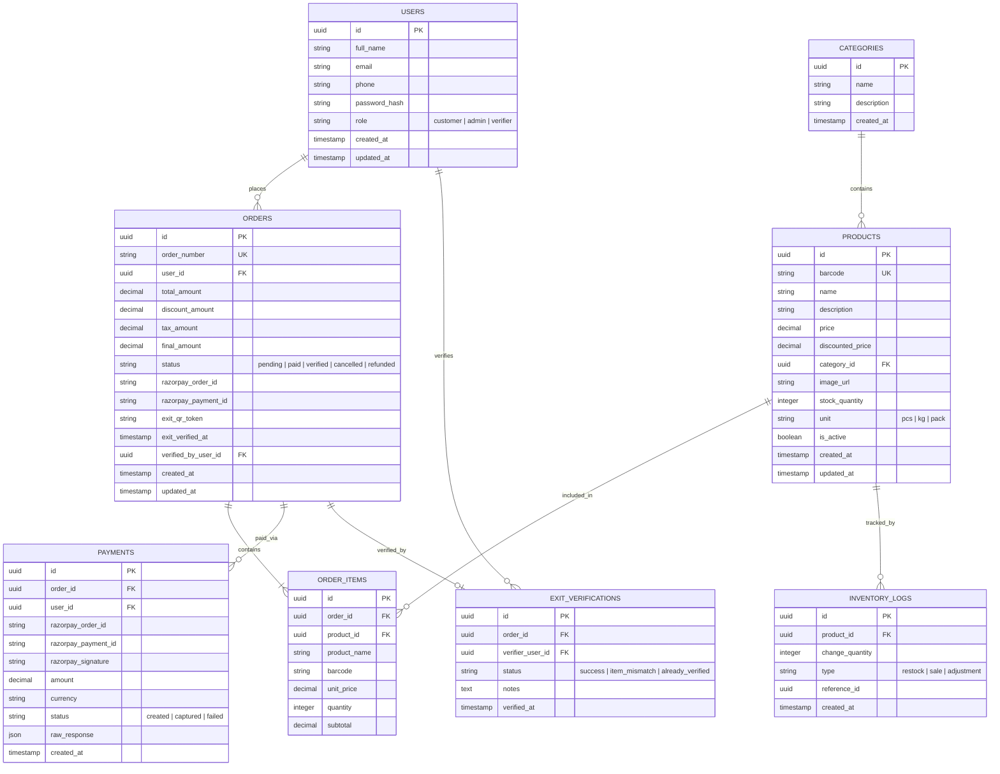

# Architecture & System Design Plan: Scan. Pay. Go. — Shopping Without Queues

## Overview
**Scan. Pay. Go.** is a modern self-checkout retail solution enabling customers to scan product barcodes using a Flutter mobile application, build a validated virtual cart, pay securely via Razorpay, generate a digital receipt, and present a dynamic exit QR code for store verification—bypassing traditional checkout queues entirely.

This document presents the complete system architecture, application boundaries, database schema, API contracts, security strategy, repository structure, and phased implementation strategy for the major project.

---

## 1. Overall System Architecture

The system strictly follows a clean **3-Tier Architecture** where the Node.js + Express backend acts as the single source of truth. Neither frontend application connects directly to PostgreSQL.

```
       +----------------------------+                  +----------------------------+
       |   Customer App (Flutter)   |                  |   Admin Dashboard (React)  |
       |  - Camera Barcode Scanner  |                  |  - Product/Inventory Mgmt  |
       |  - Cart & Checkout UI      |                  |  - Exit QR Verifier UI     |
       |  - Razorpay SDK            |                  |  - Sales & Analytics       |
       +--------------+-------------+                  +--------------+-------------+
                      |                                               |
                      | REST APIs (HTTPS / JSON)                      | REST APIs (HTTPS / JSON)
                      v                                               v
       +----------------------------------------------------------------------------+
       |                        Node.js + Express Backend API                       |
       |  - Authentication & RBAC Middleware (JWT)                                  |
       |  - Product & Barcode Lookup Service                                        |
       |  - Server-Side Cart & Total Price Validation                               |
       |  - Razorpay Payment Order & Webhook Signature Verification                 |
       |  - Exit QR Generation & One-Time Verification Engine                       |
       +---------------------+--------------------------------+---------------------+
                             |                                |
                             v                                v
                 +-----------------------+        +------------------------+
                 | PostgreSQL Database   |        | External API           |
                 | - Relational Store    |        | - Razorpay Payment GW  |
                 | - Prisma / Knex ORM   |        +------------------------+
                 +-----------------------+
```

### Key Architectural Principles:
1. **Zero Client Trust**: Product prices, discounts, taxes, and order totals calculated on the Flutter app are strictly treated as display-only. The Express backend re-evaluates all calculations from database values before creating Razorpay orders.
2. **Atomic Inventory & Verification**: Exit QR codes are dynamically generated using cryptographic signatures (HMAC/JWT) and are validated atomically to prevent reuse or fraudulent exit attempts.
3. **Stitch Design Alignment**: Frontend interfaces (Admin Web Dashboard in React & Customer App in Flutter) strictly follow the visual source of truth established in the Google Stitch designs.

---

## 2. Application Boundaries & Responsibilities

| Application Component | Tech Stack | Primary Responsibilities |
| :--- | :--- | :--- |
| **Customer App** | Flutter (Dart), Android-first | • Mobile User Auth (Login/Signup)<br>• Camera Barcode Scanning & Manual Code Entry<br>• Product Lookup & Cart State Management<br>• Server-Validated Checkout & Razorpay Payment<br>• Digital Receipt & Dynamic Exit QR Code display<br>• Order History & Profile Management |
| **Admin Dashboard** | React 18, TypeScript, Vite, Tailwind CSS | • Store Admin / Verifier Authentication<br>• Product & Barcode Inventory Management (CRUD)<br>• Exit Gate QR Verification (Camera/Webcam/Manual code)<br>• Real-time Order Monitoring & Payment Logs<br>• Sales & Stock Analytics Dashboards |
| **Backend API** | Node.js, Express.js, TypeScript/JS, PostgreSQL | • RESTful Endpoints & Middleware<br>• Single Source of Truth for Prices, Stock & Totals<br>• JWT Auth & Role-Based Authorization (Customer / Admin / Verifier)<br>• Razorpay API Integration & Webhook Handling<br>• Security Signatures for Exit QR Codes |
| **Database** | PostgreSQL | • Relational storage for users, products, categories, orders, order items, payment transactions, and exit verifications |

---

## 3. Database Entities & Schema Design



---

## 4. API Modules & Endpoints

### Auth Module (`/api/v1/auth`)
- `POST /register`: User registration (Customer)
- `POST /login`: User authentication (Customer / Admin / Verifier)
- `GET /me`: Fetch authenticated user profile
- `POST /refresh-token`: Refresh JWT session

### Products Module (`/api/v1/products`)
- `GET /barcode/:code`: Scan barcode lookup (Returns product details, live price, stock)
- `GET /`: Search/Filter product catalog
- `POST /` *(Admin)*: Create new product & assign barcode
- `PUT /:id` *(Admin)*: Update product details & price
- `DELETE /:id` *(Admin)*: Deactivate/Delete product

### Cart & Checkout Module (`/api/v1/checkout`)
- `POST /validate-cart`: Pass cart items `[{productId, quantity}]`; backend returns recalculated prices, subtotal, tax, final total & stock availability.
- `POST /create-payment-order`: Validates cart and creates Razorpay Order ID on backend.

### Payments Module (`/api/v1/payments`)
- `POST /verify-payment`: Verify Razorpay signature (`razorpay_order_id`, `razorpay_payment_id`, `razorpay_signature`), mark order as `paid`, deduct stock, generate Exit QR token.
- `POST /webhook`: Server-to-server Razorpay webhook listener for payment status updates.

### Orders & Receipts Module (`/api/v1/orders`)
- `GET /`: List customer order history
- `GET /:id`: Get detailed receipt for order
- `GET /:id/exit-qr`: Get active signed Exit QR payload for a paid order

### Exit Verification Module (`/api/v1/exit-verification`) *(Admin / Verifier)*
- `POST /scan-qr`: Decrypt & validate Exit QR payload token.
- `POST /confirm-exit`: Confirm receipt item check and mark order as `verified`.

### Admin Analytics & Stock (`/api/v1/admin`) *(Admin)*
- `GET /analytics/dashboard`: Sales overview, total revenue, peak hours, exit verifications summary.
- `GET /inventory/low-stock`: Alert products below reorder threshold.
- `POST /inventory/adjust`: Manual inventory restock/adjustment.

---

## 5. Authentication & Authorization Strategy

1. **JSON Web Tokens (JWT)**:
   - Access Token (short-lived, e.g., 15-60 mins) containing `userId`, `email`, and `role`.
   - Refresh Token (stored securely in Flutter FlutterSecureStorage / Web HTTP-only cookie).

2. **Role-Based Access Control (RBAC)**:
   - `customer`: Can search products, scan barcodes, manage own cart, pay, and view own receipts/QR.
   - `verifier`: Can scan and confirm Exit QRs at security counter.
   - `admin`: Full administrative access (Manage products, inventory, users, view sales analytics).

3. **Exit QR Security Strategy**:
   - The Exit QR code payload is NOT a plain order ID.
   - Payload format: `HMAC_SHA256(orderId + userId + timestamp + salt)`.
   - Dynamic expiration: QR code remains valid until verified or within store exit timeframe.
   - Single-use policy: Once `orders.status` is set to `verified`, any subsequent scan triggers an immediate `ALREADY_VERIFIED` warning flag on the Admin dashboard.

---

## 6. Proposed Folder Structure

```
Scan Pay Go/
│
├── backend/                        # Node.js + Express Backend API
│   ├── package.json
│   ├── tsconfig.json
│   ├── .env.example
│   ├── prisma/                     # Database Schema & Migrations
│   │   └── schema.prisma
│   └── src/
│       ├── config/                 # DB, Razorpay, Environment configs
│       ├── controllers/            # Route controllers
│       ├── middlewares/            # Auth JWT, RBAC, Validation
│       ├── models/                 # Database access layer
│       ├── routes/                 # Express API routes
│       ├── services/               # Business logic (Checkout, Razorpay, QR Signature)
│       ├── utils/                  # Helpers, logger, response formatters
│       └── app.ts                  # Express App Entrypoint
│
├── admin-dashboard/                # Admin & Verifier Web Application
│   ├── package.json
│   ├── vite.config.ts
│   ├── tailwind.config.js
│   ├── index.html
│   └── src/
│       ├── assets/
│       ├── components/             # UI Components (Buttons, Modal, Navbar, Cards)
│       ├── features/
│       │   ├── auth/               # Login page & state
│       │   ├── dashboard/          # Analytics & Overview
│       │   ├── products/           # Product CRUD & Barcode manager
│       │   ├── exit-verifier/      # QR Scanner UI (Webcam/Manual)
│       │   └── orders/             # Order & Payment tables
│       ├── hooks/                  # Custom React hooks
│       ├── services/               # Axios API client services
│       ├── store/                  # Global state management
│       └── App.tsx
│
└── customer-app/                   # Customer Flutter Mobile Application
    ├── pubspec.yaml
    └── lib/
        ├── main.dart
        ├── core/                   # Constants, Theme, API Client, Auth Interceptor
        ├── models/                 # Dart Data Models (Product, Cart, Order)
        ├── providers/              # State Management (Provider / Riverpod / Bloc)
        ├── services/               # Barcode Scanner, Razorpay Service, Storage
        └── screens/
            ├── auth/               # Login & Register screens
            ├── home/               # Product catalog & search
            ├── scanner/            # Camera Barcode Scanner screen
            ├── cart/               # Cart item view & backend checkout
            ├── payment/            # Razorpay payment handler
            ├── receipt/            # Digital receipt & Exit QR view
            └── history/            # Past Orders & User Profile
```

---

## 7. Phased Development Roadmap

### Phase 1: Foundation & Core Backend Setup
- Setup Express TypeScript server, PostgreSQL database & Prisma ORM setup.
- Define database migrations (`users`, `categories`, `products`, `orders`, `order_items`, `payments`, `exit_verifications`).
- Implement JWT Auth & RBAC Middleware.
- Seed database with sample supermarket product catalog & barcodes.

### Phase 2: Admin Web Dashboard (React + Vite + Tailwind)
- Set up Vite + React project with Tailwind CSS according to Google Stitch designs.
- Build Admin Auth & Layout navbar/sidebar.
- Build Product Management module (Add product, upload image, assign/generate barcode, set price & stock).
- Build Orders & Payment logs table.

### Phase 3: Customer App Core (Flutter)
- Set up Flutter application layout & design system matching Google Stitch UI.
- Implement User Authentication (Login/Register).
- Integrate Camera Barcode Scanner package (`mobile_scanner` / `qr_code_scanner`).
- Connect barcode scan to backend REST API (`GET /api/v1/products/barcode/:code`).
- Build Cart Manager (Add/Remove quantity, backend price sync).

### Phase 4: Checkout & Payment System (Razorpay Integration)
- Backend: Implement `/validate-cart` and `/create-payment-order` using Razorpay Node.js SDK.
- Flutter App: Integrate Razorpay Flutter SDK. Launch checkout payment modal.
- Backend: Implement payment verification endpoint (`/verify-payment`) with HMAC signature checking. Mark order as paid & record transaction.

### Phase 5: Exit Verification System
- Backend: Implement signed Exit QR payload generation & `/exit-verification/scan-qr` verification endpoint.
- Flutter App: Display dynamic Exit QR screen upon successful payment with order summary.
- Admin Web Dashboard: Build Exit Verification Module using Webcam/USB barcode scanner to scan customer exit QRs and verify item counts.

### Phase 6: Analytics, Polish & Final Testing
- Admin Web Dashboard: Build Sales Analytics & Stock Alerts dashboard.
- End-to-end integration testing: Product Scan -> Cart -> Razorpay Payment -> Receipt -> Exit QR Scan -> Inventory Deduction.

---

## 8. Potential Risks & Mitigation Strategies

| Risk | Consequence | Mitigation Strategy |
| :--- | :--- | :--- |
| **Price Tampering** | Users attempt to modify price payload sent from phone | Total calculation strictly enforced on Node.js backend. Client prices ignored. |
| **Exit QR Forgery / Reuse** | User presents fake QR or reuses screenshot of old QR | Dynamic HMAC signed QR payload containing timestamp & order ID. Single-use database flag prevents reuse. |
| **Poor Camera / Damaged Barcode** | Phone camera fails to scan damaged product barcode | Allow manual barcode numeric digits fallback entry in Flutter app. |
| **Unscanned Items Theft** | Customer leaves store with un-scanned items in bag | Admin Exit Verifier UI displays item list count & key items for quick physical visual check at store exit gate. |
| **Razorpay Payment Timeout** | Payment succeeds on Razorpay but mobile app loses connection | Backend Razorpay Webhook updates order status asynchronously even if app disconnects. |

---

## 9. Recommended Implementation Order

1. **Step 1**: Initialize backend repository, setup PostgreSQL database & Prisma schema, write seed script for products & barcodes.
2. **Step 2**: Implement Backend REST APIs (Auth, Products lookup, Cart validation, Order Creation).
3. **Step 3**: Initialize Admin Dashboard React app, implement Product CRUD UI, test barcode assignment.
4. **Step 4**: Initialize Customer Flutter app, build Barcode Scanner screen & Cart UI.
5. **Step 5**: Integrate Razorpay Payment flow (Backend Order Creation -> Flutter Payment UI -> Backend Signature Verification).
6. **Step 6**: Implement Digital Receipt & Exit QR generation on Flutter app + Exit Verification UI on Admin Dashboard.
7. **Step 7**: Perform end-to-end flow verification and polish UI styling against Google Stitch designs.

---

## User Review Required

> [!IMPORTANT]
> **Database & Stack Selection**: We propose using **Prisma ORM** with **PostgreSQL** on the Node.js backend for type safety, smooth migrations, and developer velocity.
> **Stitch Design Integration**: Before starting frontend code (Phase 2 & 3), we will inspect any connected Stitch assets/tokens to extract exact CSS variables, colors, font families, and layout structures.

## Open Questions

> [!NOTE]
> 1. Do you have existing sample product data or barcode formats (e.g. EAN-13, UPC-A, QR codes) you'd like to seed initially?
> 2. For Razorpay integration, do you have Test Key Credentials (`rzp_test_...`) ready, or should we use placeholder environment variables during initial setup?
